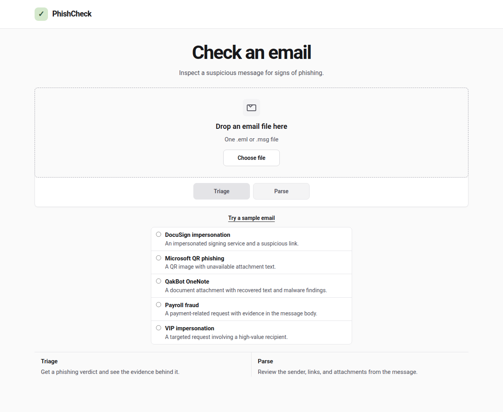
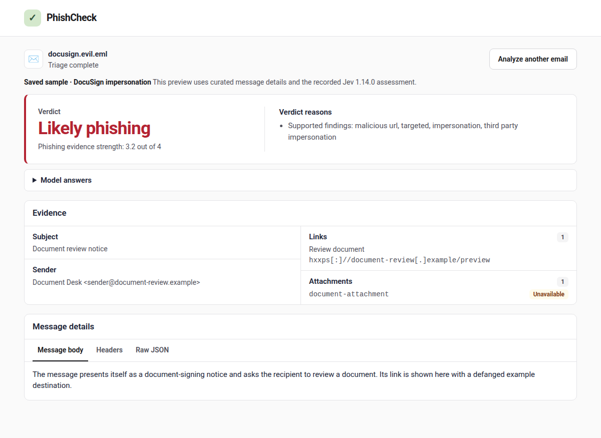
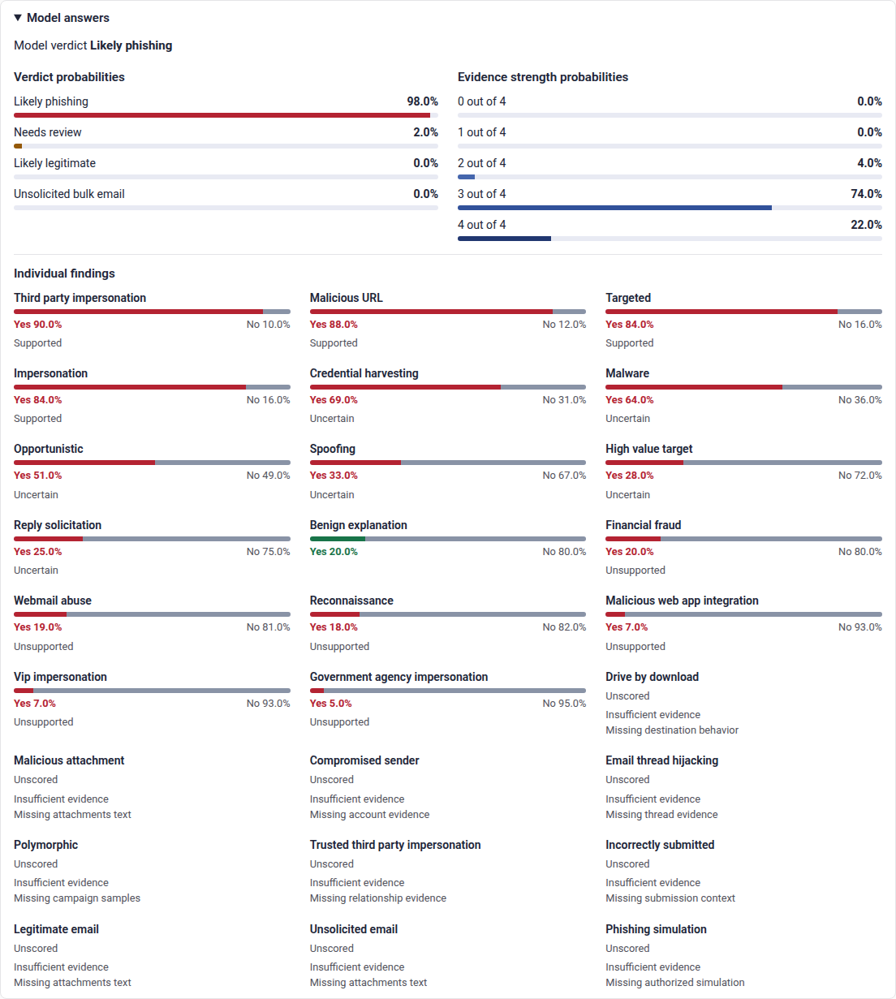

# PhishCheck

PhishCheck helps security analysts and IT responders investigate suspicious
emails saved as Outlook `.msg` or RFC 822 `.eml` files. Use the command line
for repeatable checks or the local web app to inspect one message at a time.

- **Parse** extracts headers, the message body, link text and destinations, and
  attachment findings. It works without a model provider.
- **Triage** supports only TypeSafe System One decision models, such as Jev.
  It sends selected evidence to the configured endpoint and returns a phishing
  verdict, an evidence score, and supporting findings.
- **Serve** opens the local web app for uploads and built-in sample reports.

## CLI quickstart

The published package requires Python 3.13 or newer. With `uv` installed, run:

```sh
uv tool install phishcheck
curl -fLo plain.eml https://raw.githubusercontent.com/zer0ttl/phishcheck/v0.1.0/tests/fixtures/plain.eml
phishcheck parse plain.eml
```

The sample is a synthetic email with an example.com URL. A shortened excerpt
from the parse output:

```text
File: plain.eml
SHA-256: e0407fa39df883c5cba482f2118ceb655f6cd7748b80b7a0baf2c00939373dff
Headers:
  From: analyst@example.com
  To: recipient@example.net
  Subject: Example message

Body:
Please review this harmless example: https://example.com/info

URLs:
  https://example.com/info -> https://example.com/info
Attachments:
Body extraction: complete
```

To triage the same email, set `DSPY_API_KEY` in a local `.env` file or export
`TYPESAFE_API_KEY` in your shell, then run:

```sh
phishcheck triage plain.eml --json
```

The following JSON excerpt shows the response shape. It comes from the CLI
test with a stubbed assessment, so the verdict and score are test values.

```json
{
  "triage": {
    "final_verdict": "likely_phishing",
    "phishing_evidence_score": {
      "score": 3.0
    },
    "attacks": ["spoofing"]
  },
  "parse": {
    "filename": "plain.eml"
  }
}
```

The evidence score ranges from 0 to 4 and describes the strength of the
phishing evidence. **Needs review** means the model chose review or a
probability or evidence check held back its choice.

Both `parse` and `triage` accept `--json`. Reports go to stdout and diagnostics
go to stderr. Exit status `0` means the command completed, `2` means the input
was invalid or too large, and `1` means a runtime failure. If parsing succeeded
before triage failed, the parse report is still available on stdout.

To open the web app from a local install, run `phishcheck serve` and open the
printed URL. It binds to loopback and starts at port 8000, trying the next
available port if needed. Use `phishcheck serve -p 9000` to select a fixed port.

## Docker Compose quickstart

With Docker and the Compose plugin installed, clone the repository and start
the stack:

```sh
git clone https://github.com/zer0ttl/phishcheck.git
cd phishcheck
docker compose up --build -d
```

Open `http://127.0.0.1:8000`, expand **Try a sample email**, select a sample,
and click **Triage** to see its saved report. Built-in samples need no API key.
You can also upload your own file and click **Parse**. To run a live triage,
copy `.env.example` to `.env`, set `DSPY_API_KEY`, and rerun
`docker compose up -d` to apply the settings.

To use the CLI inside the running container, copy a file from the host:

```sh
docker compose cp tests/fixtures/plain.eml app:/tmp/plain.eml
docker compose exec app phishcheck parse /tmp/plain.eml
```

Compose supplies `msgconvert`, Tika, and an MLflow server. Set
`PHISHCHECK_PORT` in `.env` if port 8000 is in use. Run `docker compose down`
to stop the stack. The named volumes, including `phishcheck-data` for SQLite
history, persist across restarts.

## Web app

Choose a file or try a built-in sample from the upload screen.



A saved triage report shows the verdict, evidence score, and supporting findings.



Expand **Model answers** to see the model's probabilities for each verdict,
evidence strength score, and individual finding.



## Prerequisites and configuration

| Task | What you need |
| --- | --- |
| Parse `.eml` or start the web app locally | Python 3.13+ and `uv` for the installation above. |
| Parse Outlook `.msg` locally | `msgconvert` on your PATH. On Debian, install `libemail-outlook-message-perl` and `libemail-address-perl`. |
| Extract attachment text and metadata, or recover a body when direct extraction fails | An optional Apache Tika server. Set `PHISHCHECK_TIKA_URL` for a local install. Compose supplies its own endpoint. Reports retain recovered evidence and identify extraction gaps. |
| Triage an uploaded email | A TypeSafe System One decision model and an API key. The default model is `typesafe:jev-latest`. Set `DSPY_API_KEY` or export `TYPESAFE_API_KEY`. |
| Record MLflow traces | Set `MLFLOW_ENABLED=true` and supply `MLFLOW_TRACKING_URI`. Compose supplies the URI. Use `MLFLOW_EXPERIMENT_NAME` to name the experiment or `triage --no-tracing` to disable tracing for one CLI run. |

See the [example environment file](https://github.com/zer0ttl/phishcheck/blob/main/.env.example)
for settings you can copy into a local `.env`. For settings with CLI flags,
explicit flags take precedence, followed by environment variables, `.env`,
and built-in defaults. `TYPESAFE_API_KEY` is a fallback when the resolved
`DSPY_API_KEY` is empty.

### Use a LiteLLM proxy

The proxy must expose the TypeSafe System One decision API. Set
`DSPY_API_BASE` to the proxy base URL and `DSPY_API_KEY` to its API key. Set
`DSPY_MODEL` to `typesafe:` followed by the model ID exposed by the proxy.
For example, if the proxy lists `typesafe/jev-1.14.0`, run:

```sh
phishcheck triage plain.eml --model typesafe:typesafe/jev-1.14.0 --json
```

### Use standalone Tika

For standalone Tika with a local PhishCheck install:

```sh
docker run --rm -p 127.0.0.1:9998:9998 apache/tika:4.2.0-2
```

In a second terminal, run
`PHISHCHECK_TIKA_URL=http://127.0.0.1:9998 phishcheck parse plain.eml`.

### Where email data goes

Triage sends selected message evidence to the model provider. When configured,
Tika receives data for extraction, and MLflow records traces for triage runs.

CLI and web runs store the original filename and email bytes, the parsed
report, and any triage inputs, responses, judgments, labels, verdict, and
diagnostics in SQLite. The default database is
`$XDG_DATA_HOME/phishcheck/history.sqlite` when `XDG_DATA_HOME` is set, or
`~/.local/share/phishcheck/history.sqlite` otherwise. Set
`PHISHCHECK_DATABASE_PATH` to choose a different location for a local install.

## Contributing and testing

Clone the repository, then install from the lockfile and run the default
offline test suite:

```sh
uv sync --locked
uv run phishcheck --help
uv run --locked pytest -q
```

Run the lint, format, typing, build, and Compose checks before opening a pull
request:

```sh
uv lock --check
uv run ruff check .
uv run ruff format --check .
uv run mypy --strict src tests
uv build
docker compose config --quiet
```

To run the optional shared email corpus, put an `emlparser` checkout beside
this repository and set its fixture path:

```sh
export PHISHCHECK_EML_FIXTURES=../emlparser/emailparser/tests/fixtures/eml
uv run pytest tests/test_eml_corpus.py -q
```

With provider credentials configured, run
`PHISHCHECK_LIVE_TESTS=1 uv run pytest tests/test_eml_corpus.py -qs` to send
selected evidence from every corpus fixture to the configured provider and
print verdicts. Set `PHISHCHECK_TIKA_URL` to include attachment extraction.
Both corpus runs use temporary SQLite databases.

Make changes on a feature branch and open a pull request against `main`.
See the [developer design notes](https://github.com/zer0ttl/phishcheck/blob/main/docs/dev/phishcheck-design.md)
for architecture and the [project instructions](https://github.com/zer0ttl/phishcheck/blob/main/AGENTS.md)
for repository conventions.
